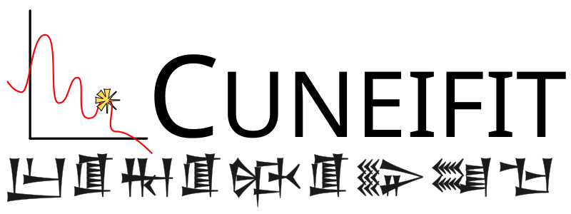

======================
Cuneifit documentation
======================

This is the main documentation for **Cuneifit**, a package for Differentiable
Likelihood and Theory codes for the Simons Observatory and related public
datasets.

*"Cuneifit"* is not an acronym, but if you want you can say it stands for
**C**\ osmological **Un**\ ified **E**\ nvironment for **I**\ nference and
**Fit**\ ting. But to be honest I just like cuneiform, but that name was
already taken.

Table of Contents
=================

.. toctree::
   :caption: Contents
   :maxdepth: 2

   installation
   code-practice

.. toctree::
   :caption: General Components
   :maxdepth: 2

   likelihood
   theory
   pipeline

.. toctree::
   :caption: Built-In Components
   :maxdepth: 2

   presets
   cmb-like
   mf-like
   cosmopower
